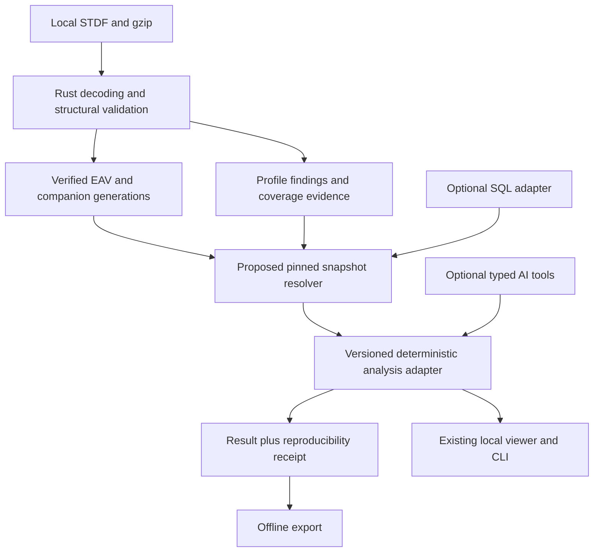

# Local-first architecture: reviewed proposal

Status: proposed implementation contracts, reviewed against checkout `732870b`
on 2026-10-31, with a first catalog-snapshot increment described below. This
document revises the supplied "Local-First Architecture and 7-Day Implementation
Backlog". Broader attempt-complete snapshots, DuckDB integration, runtime AI
and enterprise HA remain proposed work.

## Decision

Keep zstdf useful entirely offline on an engineer's workstation. Reuse the Rust
workspace, Parquet pipeline, existing browser workspace and self-contained HTML
exports. A local helper process is an implementation detail, not a separately
administered server. Accounts, API keys, SQL setup and cloud services are not
prerequisites. A packaged desktop launcher can follow independently; a new UI
framework is not required for the reproducibility work.

Adopt immutable dataset selection and explicit analysis receipts as cross-cutting
improvements (`analysis-receipt-v1` now ships for attempt-yield; see
[cli.md](../cli.md)). Keep optional query adapters and runtime AI behind this
deterministic interface. Treat future shared-server and HA deployments as
separate products of tested storage, concurrency and operational contracts.

## What the supplied response gets right, and what changes

| Proposal | Review and revised decision |
| --- | --- |
| Preserve the existing Rust components | Keep. The root Cargo workspace contains nine crates. |
| No stable unified analytics interface | Qualify. The viewer already has a typed internal `Query` plus rows/plot APIs; extract a versioned adapter rather than replace it. |
| Immutable source generations already exist | True for converted catalog generations. Raw source archival is not a catalog guarantee. |
| Historical dataset snapshots are a small catalog extension | Incomplete. Current catalog stores the latest source set, not a history API; add publication, retention, completeness and pinned-reader contracts together. |
| Failed import leaves the previous dataset unchanged | Too broad. Catalog conversion commits each successful source; a failed batch can leave a newer mixed dataset. Preserve that existing behavior and give new snapshots explicit transaction semantics. |
| Import retries cannot duplicate logical sources | Only scoped retries are established. Catalog IDs hash canonical paths; a copy under a new path is a different source. Define aliases/content dedup explicitly. |
| Create `art-v1` with attempts and PTR first | Revise. `viewer-v5` already has attempts, executions and provenance. Inventory/reuse those contracts; do not regress MPR/FTR or PRR-only attempts. |
| Rust plus mandatory DuckDB | Revise. Rust remains sufficient for the initial slice; DuckDB is optional and must prove semantic parity before serving engineering metrics. |
| Read-only SQL makes AI safe | Incorrect as a security boundary. Expose typed operations with controlled paths and outputs; do not expose arbitrary SQL or shell commands. |
| Source sanity is an ingestion quality gate | Separate malformed structure from profile-level findings. Optional records and user-configured CP/FT checks must not become unconditional ingestion failures. |
| Immutable receipts imply audit security | Qualify. Content hashes detect changes relative to trusted metadata; they do not prevent an OS user rewriting both receipt and result. |
| Disk-backed analytics belongs to future enterprise work | Incorrect sequencing. Spill infrastructure and bounded viewer queries already exist and remain a local requirement. Some legacy dashboards still use budgeted accumulators. |
| Seven days delivers ART, four analyses, DuckDB and AI | Too much unvalidated integration. Use seven gated work packages for one snapshot-to-result slice; elapsed time is an estimate, not acceptance. |
| Enterprise HA ready by design | Replace with "future deployment seams identified; HA unproven". |

## Evidence in the current checkout

| Evidence | What it establishes |
| --- | --- |
| [Workspace](../../Cargo.toml) | Root crates; no declared DuckDB runtime dependency here |
| [Catalog](../../stdf-parquet/src/catalog.rs): `DatasetCatalog`, `convert_dataset`, `verify_catalog`, `recover_dataset` | Mutable current catalog over immutable converted generations; hashes/schema/rows/path verification; per-source commits; recovery of owned staging |
| [Dataset Dashboard](../../stdf-cli/src/dashboard/dataset.rs): `generate_dataset_dashboard` | Reads one verified catalog value and referenced fragments, with memory limits; not a historical snapshot resolver |
| [Viewer model](../../stdf-cli/src/viewer/mod.rs): `Row`, `Evidence`, `Manifest`, `VERSION` | `viewer-v5`, run/attempt/execution identities, evidence and bin metadata |
| [Viewer ingestion](../../stdf-cli/src/viewer/ingest.rs): `prepare`, `reuse_dataset` | Single-source cache, decompressed source spool, verified reuse/copy of matching EAV fragments |
| [Viewer queries](../../stdf-cli/src/viewer/query.rs): `Query`, `rows`, `plot` | Typed internal requests, exact statistics, distinct sampled plot output |
| [Viewer web/export](../../stdf-cli/src/viewer/web.rs) | Loopback workspace and offline attachments; not an authorized multi-user AI endpoint |
| [Spill infrastructure](../../stdf-analytics/src/lib.rs) | Bounded external sort rather than a finished public analytics API |
| [CI](../../.github/workflows/ci.yml) | Windows Rust/license/fuzz/performance smoke; no current Linux or report-browser gate |

These are source-inspection findings, not a claim that all tests were rerun in
this documentation review. Existing CLI compatibility remains governed by
[CLI documentation](../cli.md) and [viewer documentation](../single-file-viewer-proposal.md).

## Target component boundaries

Keep storage ownership separate from analytics and UI. Define interfaces only
where the first use case needs them:

- `SnapshotCatalog.resolve(id)` returns an immutable descriptor, verification
  report and retained reader handle. Publication is a separate writer operation.
- `DataStore.open_verified(object_ref)` accepts catalog-resolved object IDs,
  not arbitrary caller paths. It distinguishes unavailable, incompatible and
  corrupt objects. A read handle remains valid while its snapshot is pinned.
- `AnalysisService.execute(request, snapshot_handle)` resolves explicit policies,
  budgets, selected population and coverage; returns typed results and evidence.
- `AnalysisRecorder.publish(result, receipt)` writes an append-only analysis
  bundle into a separate output store and returns its ID after publication.

These are proposed responsibilities, not existing Rust trait declarations.
Introduce a library extraction only after the first adapter has parity tests;
adding a service per crate or a new database solely for abstraction is unnecessary.

## Optional runtime AI and optional SQL

Runtime AI may choose among allowed, versioned operations and explain returned
results. It cannot redefine pass/fail, identity, populations or validation policy.
A read-only dataset capability does not imply a read-only process: result receipts
are written by a separate trusted recorder. Plot/export requests are bounded and
have explicit destinations. Cloud calls require an explicit data-release decision;
local analysis does not secretly install extensions, download models or send data.

DuckDB is not required for the first release slice. If introduced later, pin its
version, bind it to verified snapshot objects, use fixed parameterized operations,
and test limits and outputs against Rust. "Read-only" database access alone does
not restrict file reads, network access or resource use. Treat configuration
hardening as defense in depth and use OS isolation for untrusted execution, per
[DuckDB's security documentation](https://duckdb.org/docs/2.0/operations_manual/securing_duckdb/overview).

Development agents are different: they edit authorized repository code under
[AGENTS.md](../../AGENTS.md). The [bounded improvement runner](../development/improvement.md)
is a trusted development evaluator, not a runtime AI sandbox or dataset service.
Preserve both the multi-agent workflow and the independent semantic review gate.

## Scope of adoption

Adopt the contracts in [data-contracts.md](data-contracts.md), failure scenarios
in [failure-model.md](failure-model.md), and ordered work in
[implementation-backlog.md](implementation-backlog.md). The initial target is
verified dataset selection plus one exact analysis and a receipt, preserving
existing behavior. AI, DuckDB, desktop packaging and HA have independent gates.

## Implemented snapshot increments

The [catalog snapshot API and CLI](../snapshots.md) now provide explicit EAV
catalog capture/list/verification, an explicitly selected current snapshot and
immutable resolved reader selections. This narrower `catalog-snapshot-v1`
captures legacy run/revision metadata and references retained managed objects.
The separate `catalog-snapshot-pointer-v1` pointer changes only on explicit
selection. These increments do not implement the broader attempt-complete
`dataset-snapshot-v1` contract, original-container archival, retention leases or
snapshot-backed Dashboard queries. Separate shipped `analysis-receipt-v1`
publication for attempt-yield is outside this catalog-snapshot increment.

[Retained viewer evidence](../retained-evidence.md) now adds separately versioned
attachments for an explicit snapshot/source pair. Native records, every PRR
attempt, measurements and decompressed STDF survive disposal of temporary caches
and original source paths. Validation compares reconstructed native evidence and
checks catalog typed-row multiset equivalence; it does not invent physical
execution provenance for older catalog fragments. Coverage remains per source.
